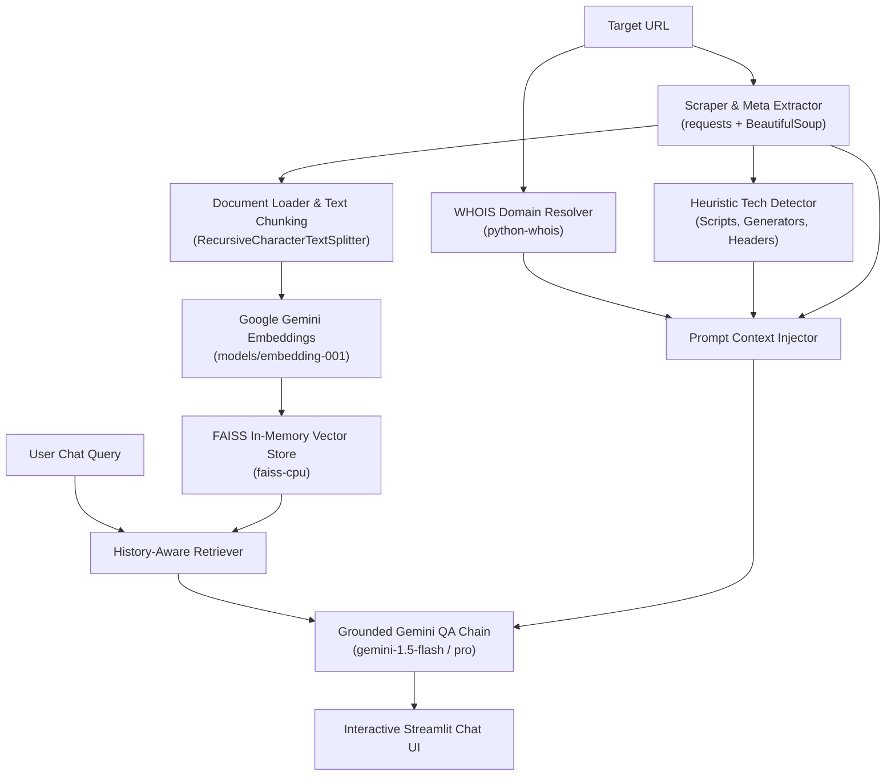

# ⚡ Web Intelligence & Tech Stack Analyzer

A production-ready Web Intelligence and Tech Stack Analysis application built with **Streamlit**, **LangChain**, **Google Gemini**, and **FAISS**.

Analyze any live website to detect CMS, frontend frameworks, hosting/CDN infrastructure, domain WHOIS records, and metadata. Chat interactively with the website's scraped content using a conversational RAG (Retrieval-Augmented Generation) pipeline.

---

## 🌟 Key Features

- **🌐 Deep Metadata & WHOIS Extraction**:
  - Domain registrar, creation date, expiration date, and country/organization hints via `python-whois`.
  - OpenGraph title, description, author/publisher tags, and footer copyright notices.
- **🛠️ Heuristic Tech Stack Detection**:
  - **CMS & Platforms**: WordPress, Shopify, Webflow, Squarespace, Wix, Ghost, Drupal, Strapi.
  - **Frontend Frameworks**: Next.js, React, Nuxt.js, Vue.js, Angular, Svelte, Astro, jQuery.
  - **Styling & UI**: Tailwind CSS, Bootstrap, Font Awesome.
  - **Hosting & CDN**: Cloudflare, Vercel, AWS CloudFront, Netlify, Fastly, GitHub Pages.
  - **Analytics & Marketing**: Google Tag Manager, Meta Pixel, Hotjar, Segment, Intercom.
- **🧠 Grounded RAG Chat Pipeline**:
  - Scrapes clean web text using `WebBaseLoader` (with resilient fallback to BeautifulSoup).
  - Chunks text into structured segments with `RecursiveCharacterTextSplitter(chunk_size=1000, chunk_overlap=150)`.
  - Computes vector embeddings using Google's `models/embedding-001` (or `text-embedding-004`).
  - Indexes chunks in an in-memory `FAISS` vector store (`faiss-cpu` for fast, lightweight deployment).
  - Grounded QA chain using `gemini-1.5-flash` or `gemini-1.5-pro` with conversational memory.
- **🎨 Glassmorphic Streamlit Dashboard**:
  - Modern dark-mode UI with metrics, visual tech badges, quick-prompt shortcuts, and full chat history.

---

## 🏗️ Architecture Pipeline



---

## 📁 Project Structure

```text
rag-web-checker/
├── app.py              # Main Streamlit application with UI & session state
├── scrapers.py         # WHOIS, metadata parsing & heuristic tech detection
├── rag_chain.py        # LangChain FAISS indexer & Gemini RAG chain
├── requirements.txt    # Pinned, lightweight Python dependencies
├── vercel.json         # Deployment configuration for Vercel (@vercel/python)
└── README.md           # Documentation & deployment guide
```

---

## 🚀 Getting Started Locally

### 1. Prerequisites
- Python 3.10, 3.11, or 3.12
- A [Google AI Studio API Key](https://aistudio.google.com/app/apikey)

### 2. Clone & Install Dependencies

```bash
# Clone the repository
git clone https://github.com/your-username/rag-web-checker.git
cd rag-web-checker

# Create a virtual environment
python3 -m venv venv
source venv/bin/activate  # On Windows use: venv\Scripts\activate

# Install dependencies
pip install --upgrade pip
pip install -r requirements.txt
```

### 3. Configure API Key

You can provide your Google Gemini API key either through the Streamlit sidebar input at runtime or by exporting an environment variable:

```bash
export GOOGLE_API_KEY="AIzaSyYourGeminiApiKeyHere"
```

### 4. Run the Streamlit Application

```bash
streamlit run app.py
```

The app will be available locally at `http://localhost:8501`.

---

## ☁️ Deployment Guide

### Option A: Deploying to Vercel

The project includes a ready-to-use [`vercel.json`](file:///Users/shivamthapa/flutter_projects/rag-web-checker/vercel.json) file configured for `@vercel/python`:

1. **Install Vercel CLI**:
   ```bash
   npm i -g vercel
   ```
2. **Deploy from CLI**:
   ```bash
   vercel
   ```
3. **Configure Environment Variables in Vercel**:
   - Go to your Project Settings on [Vercel Dashboard](https://vercel.com).
   - Navigate to **Settings** > **Environment Variables**.
   - Add `GOOGLE_API_KEY` with your Gemini API key.
   - Set `PYTHON_VERSION` to `3.11`.

> [!NOTE]
> **Vercel Serverless Architecture Note**:
> Vercel executes serverless functions with strict request timeouts (10-60s) and is stateless. Because Streamlit uses persistent WebSockets for live widget sync, the best native production hosting platforms for Streamlit apps are:
> - **[Streamlit Community Cloud](https://share.streamlit.io/)** (Free, 1-click GitHub deploy, native WebSocket support)
> - **[Railway.app](https://railway.app)** or **[Render.com](https://render.com)** (Continuous container/process hosting)

### Option B: Deploying to Streamlit Community Cloud (Recommended Free Hosting)

1. Push your repository to GitHub.
2. Visit [share.streamlit.io](https://share.streamlit.io/).
3. Connect your repository, select `app.py` as the entrypoint.
4. Under **Advanced Settings** > **Secrets**, add:
   ```toml
   GOOGLE_API_KEY = "AIzaSyYourGeminiApiKeyHere"
   ```
5. Click **Deploy**!

---

## 🔧 Error Handling & Gotchas

1. **WHOIS Lookup Timeouts / Missing TLDs**:
   - Some domain extensions (e.g., ccTLDs or privacy-shielded domains) restrict port 43 WHOIS queries. `scrapers.py` catches all lookup exceptions and returns graceful fallbacks without breaking the UI.
2. **Bot-Protection & Cloudflare Challenges**:
   - Some sites return `403 Forbidden` for standard scraping bots. `scrapers.py` and `rag_chain.py` use modern browser user-agent headers. In cases where `WebBaseLoader` is blocked, the pipeline automatically falls back to raw HTML parsing.
3. **FAISS CPU vs GPU**:
   - `faiss-cpu` is used specifically in `requirements.txt` to keep the dependency footprint small and avoid CUDA/GPU overhead on serverless or lightweight hosting.

---

## 📄 License
MIT License. Created for AI engineers and web intelligence researchers.
